# EXPLAINED: everything about this project

Read this top to bottom once and you will be able to explain every part of the build in the interview.

Contents

1. The task in plain words
2. The big picture (architecture)
3. Why I chose these tools
4. The Google Sheet: columns and statuses
5. The journey of one request, step by step
6. Every file, function by function
7. Setup guide (do this once)
8. Recording the demo video
9. Limitations and how I would improve it
10. Interview questions and answers
11. Glossary

---

## 1. The task in plain words

GoPratle connects event hosts (companies throwing offsites, team parties, launches) with vetted
event planners, DJs and crew. To get customers, a **BDR** (Business Development Representative)
has to:

1. pick a company,
2. find the right person there (someone who organises events: Events lead, HR head, or Founder),
3. find their contact details ("enrichment"),
4. write a personal message,
5. send it, and send a follow-up later if there is no reply,
6. keep a record of all of this.

This project automates all six steps. The human only types the company name and city.

---

## 2. The big picture (architecture)

```mermaid
flowchart LR
    A[Google Sheet row<br/>Company + City] --> M
    T[Telegram message<br/>'...for Zomato in Gurgaon'] -->|adds a row| A
    M[main.py<br/>agent loop] --> R[research.py<br/>web search + AI picks lead<br/>+ email lookup]
    R --> P[pitch.py<br/>AI writes 3-line pitch]
    P --> S[sheet.py<br/>log results in Sheet]
    S --> O[outreach.py<br/>send email to sandbox inbox]
    O --> F[Follow-up Due time saved]
    F -->|later, loop checks| O2[send follow-up email]
```



Same thing in text:

```
 TRIGGERS                         THE AGENT (main.py, runs in a loop every 15 s)
 ─────────                        ─────────────────────────────────────────────
 Google Sheet row  ─────┐
                        ├──►  1. find new rows (Status empty)
 Telegram message ──────┘         2. research.py  → search web, AI picks person, find email
 (bot adds a row)                 3. pitch.py     → AI writes 3-line pitch
                                  4. sheet.py     → write lead + pitch into the row
                                  5. outreach.py  → send email, save "Follow-up Due"
                                  6. every loop: rows past "Follow-up Due" → send follow-up
```

**Key design idea: the Google Sheet is the single source of truth.**
Both triggers end up as a row in the Sheet, and the agent only ever works from Sheet rows.
That means one workflow (not two), and everything the agent does is visible to the team in
the Sheet. The `Status` column acts as a small state machine (section 4), so the agent knows
what to do next with every row, even after a restart.

**How it runs:** `main.py` is a simple **polling loop**. Every `POLL_SECONDS` (15) it:

1. reads new Telegram messages (if a bot token is set),
2. processes new Sheet rows,
3. sends any follow-ups that are due,
4. sleeps.

---

## 3. Why I chose these tools

| Need | Choice | Why | Alternative |
|---|---|---|---|
| Language | **Python script** | Easy to read, every step is visible, free, runs anywhere. A reviewer can read the whole thing in 10 minutes. | n8n / Make (visual, but harder to version-control and to customise the AI logic) |
| Web search | **`ddgs` library** (searches Google/Bing/DuckDuckGo) | Free, no API key | Tavily, SerpAPI, Serper (more reliable, paid after free tier) |
| Pick the lead / write pitch | **LLM through OpenRouter**, default model `openrouter/free` | OpenRouter gives one API key for hundreds of models, and some are free. `openrouter/free` picks an available free model for each request, so the agent keeps working when a specific free model is retired. It speaks the OpenAI API format, so switching to a paid model is a one-line change in `.env`. | Hard-coded rules (worse at reading messy search results), OpenAI / Gemini directly (paid or separate keys) |
| Email lookup | **Hunter.io** (optional) + fallback guess `first.last@domain` | Hunter has a free tier. The fallback means the demo works with no key. | Apollo, Snov.io, Clearbit |
| Database / dashboard | **Google Sheets** via `gspread` | The task asks for it, and the team can see and edit it | Airtable, a real database |
| Sending email | **SMTP to Mailtrap Email Sandbox** | Mailtrap catches every email in a test inbox and delivers nothing, so no real person is spammed | Gmail SMTP, SendGrid, Resend |
| Chat trigger | **Telegram Bot API** with plain HTTP calls | Free, instant bot from @BotFather, no extra library | WhatsApp (needs Meta Business / Twilio approval) |

**Safety choices:**

- `TEST_RECIPIENT` in `.env`: when set, every email goes to that address instead of the real lead.
- Mailtrap sandbox: even if `TEST_RECIPIENT` were empty, nothing leaves Mailtrap.
- If `SMTP_HOST` is empty, emails are only printed in the terminal (dry run).
- Secrets live in `.env` and `credentials.json`, both listed in `.gitignore`, so they never reach GitHub.
- The AI is told to only pick a person who actually appears in the search results, never to invent names.

---

## 4. The Google Sheet: columns and statuses

Columns (row 1). `sheet_template.csv` has them ready to import:

| Column | Filled by | Meaning |
|---|---|---|
| Company | you / Telegram | e.g. Zomato |
| City | you / Telegram | e.g. Gurgaon |
| Status | agent (you can set "Replied") | where the row is in the workflow |
| Lead Name | agent | person found |
| Lead Title | agent | their job title |
| LinkedIn | agent | profile link |
| Email | agent | their email |
| Email Source | agent | `hunter.io` or `guessed pattern` |
| Pitch | agent | the 3-line pitch |
| Outreach Sent At | agent | time the first email was sent |
| Follow-up Due | agent | when the follow-up should go out |
| Follow-up Sent At | agent | time the follow-up was sent |
| Notes | agent | what happened, or the error message |

**Status lifecycle (the state machine):**

```
 (empty) ──► Processing ──► Contacted ──► Followed Up
                 │              │
                 │              └──► Replied   (you set this by hand → follow-up is skipped)
                 ├──► No lead found
                 └──► Error        (message in Notes; clear Status to retry)
```

- **Empty** = new, the agent will pick it up.
- **Processing** is written *first*, before the slow work, so the same row is never handled twice.
- **To retry** a row with an error, clear its Status cell.

---

## 5. The journey of one request, step by step

Example: you send the Telegram message **"Connect with event leads for Zomato in Gurgaon"**.

1. **Telegram receives it.** Within 15 seconds, the loop in `main.py` calls
   `telegram_bot.get_new_messages()`, which asks Telegram for new messages (`getUpdates`).
2. **Parse.** `telegram_bot.parse_command()` uses a regular expression to pull out
   company = `Zomato`, city = `Gurgaon`. If the message doesn't match, the bot replies with help text.
3. **Bot replies** "Searching for event leads at Zomato in Gurgaon..." so the user knows it's working.
4. **Add a row.** `sheet.add_row()` appends `Zomato | Gurgaon` to the Sheet. From here on it's the
   same as if you had typed it into the Sheet yourself.
5. **Mark as Processing.** `main.process_row()` writes `Status = Processing`.
6. **Search the web.** `research.search_people()` runs 3 searches:
   - `Zomato Gurgaon events manager linkedin`
   - `Zomato Gurgaon HR head linkedin`
   - `Zomato founder linkedin`

   It collects around 15–20 results (title, link, short text) and removes duplicates.
7. **AI picks the lead.** `research.pick_best_lead()` sends all results to the AI with rules:
   prefer Events > HR > Founder, only real people from the results, must currently work there.
   The AI answers in JSON: name, title, LinkedIn URL, company email domain, and why.
8. **Find the email.** `research.find_email()`:
   - if you have a Hunter.io key → asks Hunter for the verified email,
   - otherwise → guesses `firstname.lastname@zomato.com` and labels it `guessed pattern`.
9. **Write the pitch.** `pitch.write_pitch()` asks the AI for exactly 3 lines:
   a personal hook, what GoPratle does, and a soft call to action.
10. **Log to the Sheet.** Name, title, LinkedIn, email, email source and pitch go into the row.
11. **Send the outreach email.** `pitch.first_email()` wraps the pitch in "Hi Rohit, ... Best, ...",
    and `outreach.send_email()` sends it over SMTP to the Mailtrap sandbox inbox.
12. **Schedule the follow-up.** `Follow-up Due = now + FOLLOWUP_DELAY_MINUTES` (2 min for the demo,
    3 days in real use). Status becomes `Contacted`. The row is saved.
13. **Bot replies** with the lead, LinkedIn, email, the pitch, and the follow-up time.
14. **Follow-up.** On every loop, `main.send_due_followups()` looks for rows with
    `Status = Contacted` whose `Follow-up Due` has passed. It sends the follow-up email and sets
    `Status = Followed Up`. If you had changed the Status to `Replied`, it would skip that row.

If you type a row into the Sheet directly, steps 1–4 are skipped. The loop finds the row
because its Status is empty, and steps 5–14 run the same way (minus the Telegram replies).

---

## 6. Every file, function by function

### `config.py`
Loads `.env` with `python-dotenv` and exposes each setting as a variable, e.g. `config.LLM_MODEL`.
Every other file imports settings from here, so there are no secrets in the code.

### `llm.py`
- `_get_client()` creates the client once, pointed at OpenRouter (`LLM_BASE_URL`). We use the
  `openai` Python library because OpenRouter accepts the same request format as OpenAI.
  The two extra headers (`HTTP-Referer`, `X-Title`) are optional; they only label the app on
  OpenRouter's dashboard.
- `_clean(text)`: some free models "think out loud" inside `<think>...</think>` or wrap JSON in
  ```` ```json ```` fences. This removes both.
- `_to_json(text)`: finds the `{ ... }` part of the answer and turns it into a Python dict, even if
  the model wrote a sentence before or after it.
- `ask(prompt, want_json=False)` sends one message and returns the text (or a dict with
  `want_json=True`, which also asks the model for JSON mode). Free models are sometimes busy
  (HTTP 429 "too many requests"), so it **retries up to 3 times**, waiting 5 s then 10 s.
  `temperature=0.3` keeps answers fairly consistent.

### `research.py`
- `SEARCH_QUERIES`: the 3 search templates (Events, HR, Founder).
- `web_search(query)`: free search using `ddgs`. It tries Google, then Bing, then "auto",
  because free search engines sometimes return nothing.
- `search_people(company, city)`: runs all 3 queries and removes duplicate links.
- `pick_best_lead(company, city, results)`: numbers the results, writes the prompt with the
  rules, and returns the AI's JSON answer, or `None` if no one fits.
- `find_email(name, company, domain)`: cleans the name into first/last, tries Hunter.io,
  falls back to the guessed pattern. Returns `(email, source)` so the Sheet shows how reliable it is.
- `research(company, city)`: runs the three steps above in order and returns one dict.

### `pitch.py`
- `GOPRATLE`: one sentence about what GoPratle does, given to the AI.
- `write_pitch(lead, company, city)`: prompt with strict rules (3 lines, under 60 words,
  no emojis/placeholders). Keeps only the first 3 non-empty lines, in case the AI adds extra.
- `first_email(...)`: subject + body around the pitch.
- `followup_email(...)`: a fixed template. It doesn't need AI, so it is free and predictable.

### `sheet.py`
- `HEADERS`: the column names, in order.
- `open_sheet()`: logs in with the Google service account (`credentials.json`), opens the
  Sheet by ID, and writes the headers if row 1 is empty. If row 1 has different headers it stops
  with an error instead of overwriting your data.
- `get_rows(worksheet)`: reads every row as a dict like `{"Company": "Zomato", ...}` plus its row
  number (row 2 is the first data row because row 1 is the header).
  `numericise_ignore=["all"]` keeps all values as text.
- `update_row(worksheet, row_number, row)`: writes a whole row in **one** API call (Google limits
  how many calls you can make per minute).
- `add_row(worksheet, company, city)`: appends a row and reads the row number from Google's reply.

### `outreach.py`
- `send_email(to, subject, body)`:
  1. picks the recipient: `TEST_RECIPIENT` if set, otherwise the lead's email,
  2. if no SMTP is configured, prints the email (dry run),
  3. otherwise builds the email, connects to the SMTP server, upgrades to an encrypted connection
     (STARTTLS) if the server supports it, logs in, and sends.

### `telegram_bot.py`
- `COMMAND`: a regular expression that matches `... for <Company> in <City>`.
- `_call(method, ...)`: one HTTP POST to `https://api.telegram.org/bot<TOKEN>/<method>`.
- `get_new_messages()`: calls `getUpdates`. `_next_update_id` tells Telegram which messages we
  already read, so each message is handled once.
- `parse_command(text)`: returns `(company, city)` or `None`.
- `reply(chat_id, text)`: calls `sendMessage`.

### `main.py`
- `process_row(...)`: the full workflow for one company (section 5, steps 5–12). Everything is
  inside `try/except`: if anything fails, the row gets `Status = Error` and the error text in
  Notes, and the agent moves on to the next row.
- `process_new_rows(...)`: trigger 1, the Sheet. Picks rows with Company + City and empty Status.
- `send_due_followups(...)`: the follow-up scheduler.
- `handle_telegram(...)`: trigger 2, Telegram. Parses the message, adds a row, runs
  `process_row`, replies with the result.
- `run_agent()`: the forever loop. A network error in one round is printed and the loop continues.
- `run_test(company, city)`: `python main.py test "Zomato" "Gurgaon"` does research + pitch and
  prints them. It doesn't touch the Sheet or send email, so it's good for checking your AI key.

---

## 7. Setup guide (do this once)

You need Python 3.10 or newer.

### 7.1 Install
```bash
git clone https://github.com/m-bhavyaa/gopratle-agent.git
cd gopratle-agent
python -m venv .venv
source .venv/bin/activate          # Windows: .venv\Scripts\activate
pip install -r requirements.txt
cp .env.example .env               # Windows: copy .env.example .env
```

### 7.2 AI key (free, OpenRouter)
1. Sign up at https://openrouter.ai (no credit card needed).
2. Go to https://openrouter.ai/keys, click **Create Key**, and paste it as `LLM_API_KEY` in `.env`.
   Keep `LLM_BASE_URL=https://openrouter.ai/api/v1` and `LLM_MODEL=openrouter/free`.
3. Check it works: `python main.py test "Zomato" "Gurgaon"`
4. Free limits: 20 requests per minute and 50 per day (1,000 per day after a one-time $10 credit
   purchase). Each lead uses 2 AI calls, so that's about 25 leads a day for free.
5. Optional: if answers from random free models vary too much, pin one free model, e.g.
   `LLM_MODEL=google/gemma-4-31b-it:free`. The current list is at
   https://openrouter.ai/models?max_price=0 (free models change often).

### 7.3 Google Sheet + service account
A **service account** is a "robot Google user" that the script logs in as.
1. Go to https://console.cloud.google.com and create a project.
2. Go to **APIs & Services → Library**, and enable **Google Sheets API** and **Google Drive API**.
3. Go to **IAM & Admin → Service Accounts → Create service account** (any name, no roles needed).
4. Open it, go to **Keys → Add key → Create new key → JSON**. A file downloads.
   Rename it `credentials.json` and put it in the project folder.
5. Create a Google Sheet. **File → Import → Upload** `sheet_template.csv` (choose "Replace current sheet").
6. Click **Share** and share the Sheet with the service account's email
   (looks like `name@project.iam.gserviceaccount.com`) as **Editor**.
7. Copy the Sheet ID from the URL (`docs.google.com/spreadsheets/d/<THIS_PART>/edit`) into
   `GOOGLE_SHEET_ID` in `.env`.

### 7.4 Sandbox email (Mailtrap)
1. Sign up at https://mailtrap.io and open **Email Testing / Sandbox → your inbox**.
2. Open **SMTP settings** and copy the username and password into `SMTP_USER` / `SMTP_PASSWORD`.
   Host `sandbox.smtp.mailtrap.io`, port `2525` are already in `.env.example`.
3. Sent emails appear in that Mailtrap inbox. Nothing is delivered to real people.

### 7.5 Telegram bot (optional)
1. In Telegram, open **@BotFather**, send `/newbot`, and follow the steps.
2. Paste the token as `TELEGRAM_BOT_TOKEN` in `.env`.
3. Open your new bot and press **Start**.

### 7.6 Email finder (optional)
Sign up at https://hunter.io, copy the API key into `HUNTER_API_KEY`. Without it, emails are guessed.

### 7.7 Run
```bash
python main.py
```
Leave it running. Add a row to the Sheet, or message the bot.

---

## 8. Recording the demo video (about 2–3 minutes)

Before recording: set `FOLLOWUP_DELAY_MINUTES=2` and arrange the Sheet, terminal, Telegram and
Mailtrap so you can switch between them quickly.

1. **(15 s) Intro:** "This is a Python agent. The Google Sheet is the database, Telegram and the Sheet are the triggers."
2. **(15 s)** Run `python main.py` in the terminal.
3. **(40 s) Trigger 1:** type `Zomato | Gurgaon` into the Sheet. Show the Status go to
   Processing, then Contacted, with lead, LinkedIn, email and pitch filled in.
4. **(40 s) Trigger 2:** in Telegram send "Connect with event leads for Swiggy in Bangalore".
   Show the bot's reply and the new row in the Sheet.
5. **(20 s)** Open Mailtrap and show the outreach emails.
6. **(30 s)** After 2 minutes, show Status = Followed Up and the follow-up email in Mailtrap.
   Optionally set one row to `Replied` before it is due, to show that its follow-up is skipped.
7. **(15 s)** Show the GitHub repo quickly.

---

## 9. Limitations and how I would improve it

Be ready to say these yourself. Interviewers like candidates who know the weak spots.

| Limitation | Improvement |
|---|---|
| OpenRouter free models: 50 requests/day, quality varies by which model is picked | Pin one good free model, or use a cheap paid model for steady quality and no daily cap |
| Free web search can be flaky or rate-limited | Use a paid search API (Tavily / SerpAPI) or Apollo's people search |
| LinkedIn snippets can be out of date (person may have left) | Verify with a second source, show a confidence score, have a human approve before sending |
| Guessed emails can bounce | Hunter / Apollo verification, or skip sending when the email is only a guess |
| Reply detection is manual ("Replied" status) | Read the inbox (Gmail API / IMAP) and set Replied automatically |
| Polling loop must keep running on a computer | Deploy on a small server / cron job, or use Google Sheets / Telegram webhooks |
| One follow-up only | Multi-step sequence (day 3, day 7) with different messages |
| No WhatsApp | Add a WhatsApp trigger with the Twilio WhatsApp sandbox (same `parse_command`, new transport) |
| Sends right away | A "Review" status so a human approves the pitch first (human in the loop) |
| Compliance | Unsubscribe line, respect opt-outs, follow email/anti-spam laws (e.g. India DPDP Act, CAN-SPAM, GDPR) |

---

## 10. Interview questions and answers

**Q: Walk me through your architecture.**
Two triggers (Google Sheet, Telegram) feed into one place, the Sheet. A Python loop checks the
Sheet every 15 seconds. For each new row it researches the lead (web search + AI), writes a
pitch (AI), logs to the Sheet, sends the email to a sandbox inbox and schedules a follow-up.
The Status column tracks each row's state.

**Q: Why Python and not n8n or Make?**
I wanted full control over the AI logic and fallbacks, it costs nothing, and the code is easy to
review in Git. The same design maps to n8n easily: a Google Sheets Trigger node, an HTTP node for
search, an OpenAI node for picking the lead and writing the pitch, a Google Sheets Update node,
a Send Email node, and a Schedule trigger for follow-ups.

**Q: How do you stop the AI from inventing people?**
The prompt says it may only choose people who appear in the search results, and I log the
LinkedIn URL so a human can check it in one click. A next step would be to check in code that the
returned name appears in the search text.

**Q: How does the follow-up scheduling work?**
After the first email I store a `Follow-up Due` time in the Sheet. Each loop compares it with the
current time. Storing it in the Sheet (not in memory) means follow-ups survive a restart.

**Q: What if two loops process the same row?**
The agent writes `Processing` before doing the slow work, so the next loop skips the row. With
one running agent this is enough. With many workers I'd use a real queue or database lock.

**Q: What happens when something fails?**
Each row runs inside `try/except`. A failure marks only that row as `Error` with the reason in
Notes, and the agent continues with the other rows. Clearing the Status cell retries it.

**Q: How did you keep it safe to test?**
Mailtrap sandbox catches all emails, `TEST_RECIPIENT` redirects every email, there's a dry-run
mode without SMTP, and secrets stay in `.env` (git-ignored).

**Q: How much does it cost?**
Zero for the demo: OpenRouter free models, free search, Google Sheets, Mailtrap free, Telegram free.
In production, the main costs would be a reliable search/enrichment API and the LLM. With
OpenRouter I'd switch `LLM_MODEL` to a small paid model, which costs a fraction of a cent per lead
and removes the 50-requests-a-day free limit.

**Q: Why OpenRouter?**
One key gives access to many models, including free ones. `openrouter/free` routes to whichever
free model is available, so the demo doesn't break when one model is retired. Because it uses the
OpenAI request format, moving to GPT, Claude or Gemini later only changes `LLM_MODEL`.
Because free models differ in quality, I added retries and JSON cleanup in `llm.py`.

**Q: How would you scale it to 1,000 leads a day?**
Replace polling with webhooks or a queue, run searches in parallel with rate limits, use a paid
enrichment API, move from Sheets to a database (keep the Sheet as a view), send email through a
proper provider with domain warm-up, and add monitoring for bounce and reply rates.

**Q: How would you measure if it works?**
Lead-found rate, email bounce rate, reply rate, meetings booked, and time saved per lead compared
with doing it by hand.

---

## 11. Glossary

- **BDR**: Business Development Representative, the salesperson who finds and first contacts leads.
- **Lead enrichment**: adding details (name, title, email, LinkedIn) to a basic lead like "Zomato, Gurgaon".
- **LLM**: Large Language Model, the AI (here a free model via OpenRouter) that reads text and writes text.
- **Prompt**: the instructions and data we send to the LLM.
- **JSON**: a simple text format for structured data: `{"name": "Rohit"}`.
- **API**: a way for programs to talk to a service over the internet.
- **API key**: a password that lets your program use an API.
- **OpenAI-compatible API**: many AI providers accept the same request format as OpenAI, so one client works for all.
- **Service account**: a robot Google account the script uses to edit the Sheet.
- **SMTP**: the standard protocol for sending email.
- **STARTTLS**: switches an SMTP connection to encrypted.
- **Sandbox**: a safe test environment. Mailtrap's sandbox catches emails instead of delivering them.
- **Polling**: checking for new work every few seconds (the opposite is a webhook, where the service calls you).
- **Webhook**: a URL that a service calls the moment something happens.
- **State machine**: a fixed set of states (our Status values) and the rules to move between them.
- **Regular expression (regex)**: a pattern for finding text, used to read "for X in Y".
- **`.env` file**: a local file holding secrets and settings, never committed to Git.
